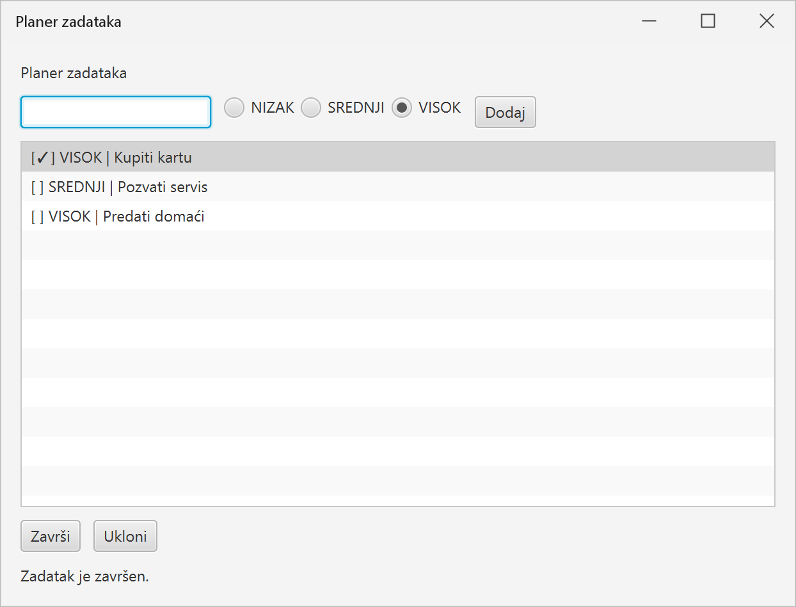
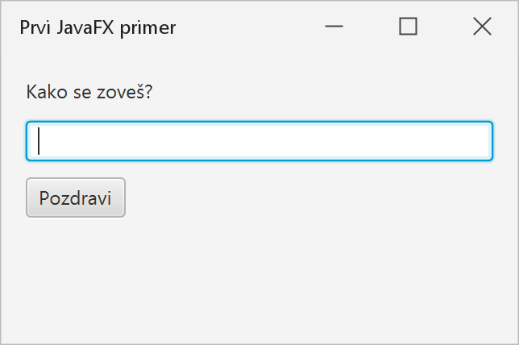
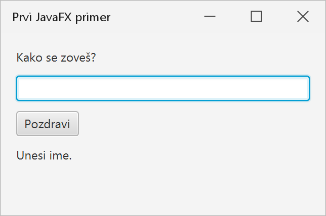
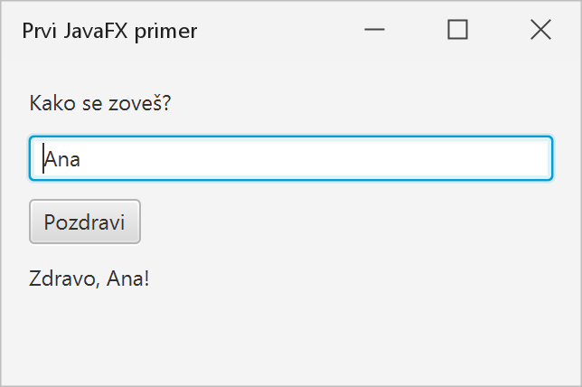
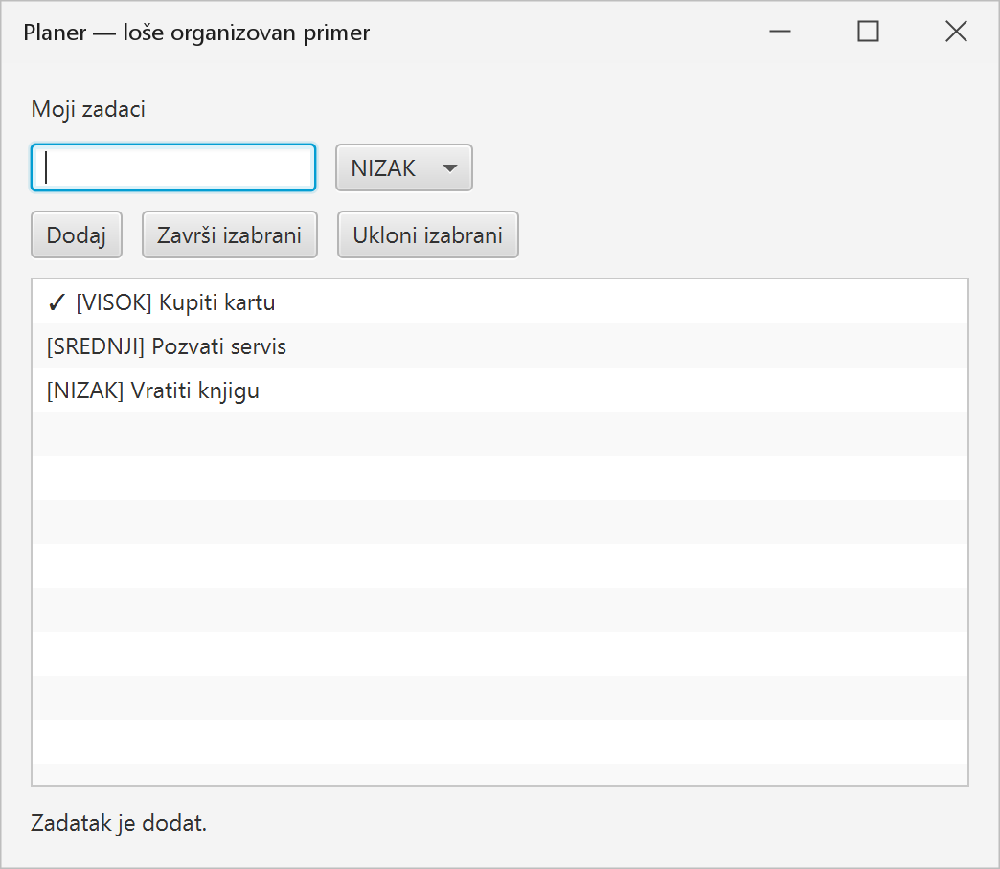
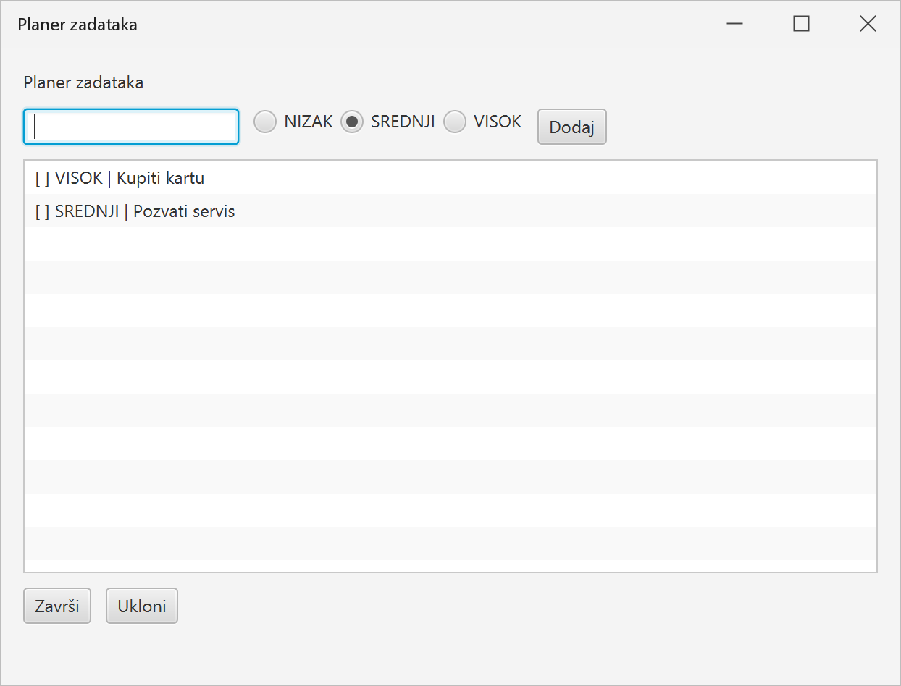
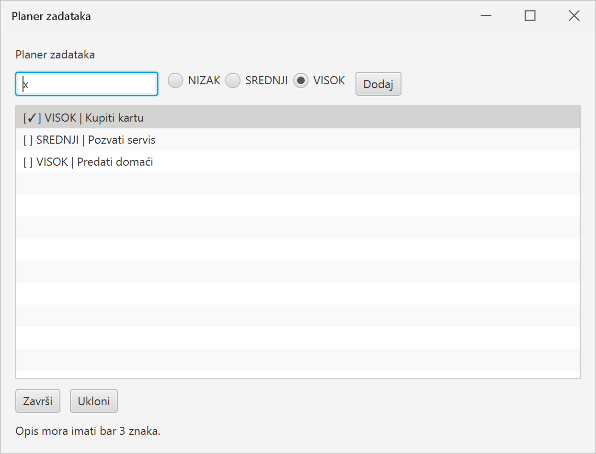

# Недеља 12 — JavaFX и одвајање модела од корисничког интерфејса

> **Код:** [GitHub](https://github.com/MatfOOP-I/info/tree/main/vezbe/primeri-java/12.javafx.odvajanje.modela.i.ui) · [преузми пројекат (ZIP)](../12.javafx.odvajanje.modela.i.ui.zip) · [задатак за самостални рад](ZADATAK.md)

Ове недеље први пут правимо графичку апликацију.

Циљ није само да научимо:

```text
Button
Label
TextField
VBox
HBox
ListView
ChoiceBox
RadioButton
ToggleGroup
```

него и да задржимо ООП принципе које смо градили током целог курса.

Најважнија порука ове недеље је:

> **Кориснички интерфејс није модел програма.**

JavaFX треба да:

- прикаже податке;
- прочита кориснички унос;
- реагује на догађаје;
- позове одговарајућу операцију апликације;
- поново освежи приказ.

Правила домена и стање апликације не треба да живе у `Button` handlerima.

## Шта правимо

На крају часа имаћемо планер задатака: унос описа, избор приоритета, листа задатака и дугмад за завршавање и уклањање.



До њега стижемо у неколико корака, од најједноставнијег прозора до апликације са раздвојеним моделом, контролером и приказом.

---

## Домен

Правимо једноставан планер задатака.

Задатак има:

- опис;
- приоритет;
- информацију да ли је завршен.

Приоритет је:

```java
public enum Prioritet {
    NIZAK,
    SREDNJI,
    VISOK
}
```

Апликација треба да омогући:

- додавање задатка;
- приказ свих задатака;
- означавање изабраног задатка као завршеног;
- уклањање задатка.

Домен је намерно једноставан.

Нова тема ове недеље треба да буде **организација GUI апликације**, а не разумевање пословног домена.

---

## Циљеви

После вежби студент треба да уме да:

- објасни основни животни циклус JavaFX апликације;
- разликује `Stage`, `Scene` и JavaFX контроле;
- користи основне layout контејнере;
- реагује на догађај дугмета;
- објасни шта је event handler;
- препозна проблем када UI директно чува и мења стање домена;
- издвоји модел у обичне Java класе;
- направи UI који користи модел, али модел не зна да JavaFX постоји;
- разуме улогу малог контролера између приказа и модела;
- објасни смер зависности између слојева.

---

## Жељени смер зависности

У завршном примеру имамо:

```text
        JavaFX
          |
          v
       prikaz
          |
          v
      kontroler
          |
          v
        model
```

Дозвољено је:

```text
prikaz      → kontroler
kontroler   → model
prikaz      → model   (samo radi prikaza podataka)
```

Није дозвољено:

```text
model → javafx.*
```

Модел не треба да зна:

- да постоји дугме;
- да постоји `TextField`;
- да постоји `ListView`;
- да постоји прозор;
- које је боје текст;
- шта се дешава када корисник кликне.

---

## Зашто је то важно?

Ако је модел обична Java:

```java
ListaZadataka lista = new ListaZadataka();
lista.dodaj("Kupiti kartu", Prioritet.VISOK);
```

онда исти модел можемо користити:

- из JavaFX апликације;
- из конзолног програма;
- из тестова;
- једног дана из неког другог UI-ја.

Ако пословна логика живи у:

```java
dugme.setOnAction(...)
```

онда је она везана за конкретан UI.

---

## Редослед примера

### [`primer01_osnove`](https://github.com/MatfOOP-I/info/tree/main/vezbe/primeri-java/12.javafx.odvajanje.modela.i.ui/src/primer01_osnove)

Минимална JavaFX апликација.

Уводимо:

```text
Application
start(...)
Stage
Scene
VBox
Label
TextField
Button
```

и први догађај:

```java
dugme.setOnAction(...)
```

Овај пример је намерно мали.

Циљ је само да студент разуме основну структуру JavaFX апликације.

| На почетку | Клик без унетог имена | После уноса имена и клика |
|---|---|---|
|  |  |  |

---

### [`primer02_sve_u_ui`](https://github.com/MatfOOP-I/info/tree/main/vezbe/primeri-java/12.javafx.odvajanje.modela.i.ui/src/primer02_sve_u_ui)

Правимо мали планер, али намерно лоше.



Споља се не види ништа лоше — проблем је у коду.

Класа JavaFX апликације:

- чува листу задатака;
- проверава валидацију;
- додаје задатак;
- форматира задатак;
- мења стање;
- ажурира GUI.

Све је у једном месту.

Приоритет се бира у `ChoiceBox<String>` са текстовима `NIZAK`, `SREDNJI` и `VISOK`, а задатак је обичан `String`, на пример `"[VISOK] Kupiti kartu"`.

Програм ради.

То је важно:

> Лош дизајн не значи нужно да програм не ради.

Проблем је што се одговорности мешају.

Посебно обратите пажњу на то како се памти да је задатак завршен:

```java
zadaci.set(indeks, "✓ " + zadatak);
```

Стање „завршен“ је записано **у тексту** који се приказује. Приказ и стање су исти `String`: да бисмо сазнали да ли је задатак завршен, морамо да проверавамо како почиње текст (`startsWith("✓ ")`), а приоритет је такође само део текста. Кад бисмо променили начин приказа (на пример `[KRAJ]` уместо `✓`), покварило би се и стање. У следећим примерима стање добија право место у класи `Zadatak`, а приказ га само чита.

---

### [`primer03_model_bez_javafx`](https://github.com/MatfOOP-I/info/tree/main/vezbe/primeri-java/12.javafx.odvajanje.modela.i.ui/src/primer03_model_bez_javafx)

Издвајамо:

```text
model/
    Prioritet
    Zadatak
    ListaZadataka
```

Ниједна од ових класа не импортује ништа из `javafx.*`.

Додајемо обичан:

```java
Main
```

који модел користи из конзоле.

Тиме доказујемо да модел постоји независно од GUI-ја.

#### Важна идеја

Ако морамо да покренемо JavaFX да бисмо проверили да ли:

```java
zavrsiZadatak(...)
```

ради, вероватно смо превише логике ставили у UI.

---

### [`primer04_kontroler`](https://github.com/MatfOOP-I/info/tree/main/vezbe/primeri-java/12.javafx.odvajanje.modela.i.ui/src/primer04_kontroler)

Између UI-ја и модела уводимо мали:

```java
KontrolerZadataka
```

Контролер:

- прима корисничку намеру;
- позива модел;
- враћа резултат операције.

Резултат је мали `record` `RezultatOperacije` са пољима `uspesno` и `poruka`; приказ га чита позивима `rezultat.uspesno()` и `rezultat.poruka()`.

Ако ништа није изабрано (индекс је негативан), контролер то пријављује као обичну грешку корисника. Остали неисправни индекси су грешка позиваоца, па изузетак из модела намерно не хватамо.

Ни контролер не зависи од JavaFX-a.

Ово није час о формалном MVC обрасцу.

Поента је само да раздвојимо три врсте одговорности:

```text
model      — podaci i pravila
kontroler  — operacije aplikacije
prikaz     — korisnički interfejs
```

---

### [`primer05_zavrsna_aplikacija`](https://github.com/MatfOOP-I/info/tree/main/vezbe/primeri-java/12.javafx.odvajanje.modela.i.ui/src/primer05_zavrsna_aplikacija)

Спајамо све.

| На почетку | Прекратак опис |
|---|---|
|  |  |

Порука о грешци долази из модела (`Zadatak` не дозвољава прекратак опис), а приказ је само исписује.

Структура:

```text
primer05_zavrsna_aplikacija/
    model/
        Prioritet.java
        Zadatak.java
        ListaZadataka.java

    kontroler/
        KontrolerZadataka.java
        RezultatOperacije.java

    prikaz/
        PlanerAplikacija.java
        PrikazPlanera.java
```

`PrikazPlanera` прави JavaFX контроле.

Када корисник кликне:

```text
Dodaj
```

UI:

1. прочита садржај `TextField`;
2. позове `kontroler.dodajZadatak(...)`;
3. освежи приказ.

UI **не додаје директно** објекат у доменску листу.

#### Избор приоритета: `RadioButton` и `ToggleGroup`

Приоритет се бира помоћу три `RadioButton` дугмета (`NIZAK`, `SREDNJI`, `VISOK`) поређана у `HBox` поред поља за опис.

- Сва три дугмета су у истој `ToggleGroup`. Група обезбеђује да у једном тренутку буде изабрано **само једно** дугме: избор једног аутоматски поништава избор претходног. Без групе би свако дугме било независно и могла би бити изабрана сва три.
- Дугмад правимо петљом преко `Prioritet.values()`, а сам `Prioritet` чувамо у `setUserData(...)`. Тако из изабраног дугмета (`grupa.getSelectedToggle()`) читамо вредност enum-а позивом `getUserData()`, уместо да поредимо текст на дугмету.
- `SREDNJI` је изабран од почетка. Клик на већ изабрани `RadioButton` не поништава избор, па је после тога увек изабран тачно један приоритет.

Модел и контролер не знају за `RadioButton`: контролер добија само `Prioritet`.

---

## Модел не треба да враћа JavaFX колекције

Намерно не користимо:

```java
ObservableList<Zadatak>
```

унутар модела.

Зашто?

Зато што би тада модел морао да импортује JavaFX.

Уместо тога модел враћа:

```java
List<Zadatak>
```

Приказ одлучује како ће ту листу приказати.

Касније, у већим JavaFX апликацијама, постоје различити начини повезивања модела и UI-ја.

За овај курс је важније да граница између слојева остане јасна.

---

## Event handler

Код:

```java
dugme.setOnAction(dogadjaj -> {
    ...
});
```

значи:

> када се деси догађај `ActionEvent`, изврши ову функцију.

Ово је догађајни начин програмирања.

Програм више не иде само линеарно:

```text
naredba 1
naredba 2
naredba 3
```

Већи део времена апликација чека корисничку акцију:

```text
klik
unos
izbor
zatvaranje prozora
```

---

## Observer идеја

Не уводимо Observer као нову велику design-pattern тему.

Довољно је приметити идеју:

> један објекат може да региструје реакцију на догађај другог објекта.

На пример:

```java
dugme.setOnAction(...)
```

Дугме производи догађај.

Наш код региструје реакцију.

То је довољно за овај курс.

---

## Шта припада моделу?

На пример:

```java
if (opis == null || opis.isBlank()) {
    ...
}
```

Ако задатак без описа нема смисла у домену, модел треба да штити то правило.

Исто важи за:

```java
zavrsi()
```

Стање задатка припада објекту `Zadatak`.

---

## Шта припада приказу?

На пример:

```text
boja teksta
raspored kontrola
širina prozora
tekst na dugmetu
formatiranje zadatka za prikaz
poruka korisniku
```

Модел не треба да зна да ли је завршен задатак приказан као:

```text
✓ Kupiti kartu
```

или:

```text
[KRAJ] Kupiti kartu
```

То је одлука приказа.

---

## Контролер није "све што није UI"

Контролер треба да остане мали.

Лош резултат рефакторисања би био:

```text
pre: sva logika u JavaFX klasi
posle: sva logika u ogromnom Kontroler.java
```

Правила појединачног објекта и даље припадају моделу.

На пример:

```java
zadatak.zavrsi();
```

припада класи `Zadatak`.

---

## Зашто не FXML ове недеље?

JavaFX подржава FXML и Сцене Builder.

Они могу бити корисни у већим апликацијама, али би ове недеље увели:

- додатни формат фајла;
- анотације;
- повезивање FXML-a и контролера;
- још један скуп правила.

Имамо само 13 недеља.

Зато UI градимо програматски у Јави, а време трошимо на важнију идеју:

> **одвајање модела и приказа.**

FXML се касније може научити веома брзо када је ова архитектонска граница јасна.

---

## Питања за дискусију

1. Зашто модел не треба да импортује `javafx.scene.control.Button`?
2. Да ли UI сме да користи објекте модела?
3. Ко треба да провери да задатак нема празан опис?
4. Ко треба да одлучи како се завршен задатак приказује?
5. Зашто модел враћа `List<Zadatak>`, а не `ObservableList<Zadatak>`?
6. Шта је event handler?
7. Зашто програм не завршава одмах после `start()` методе?
8. Ко треба да реагује када корисник кликне "Додај"?
9. Да ли `KontrolerZadataka` треба да мења боју `Label` контроле?
10. Да ли модел може да ради без JavaFX-a?
11. Како бисмо то доказали?
12. Где бисмо додали чување задатака у фајл?
13. Да ли би због тога требало мењати класу `PrikazPlanera`?
14. Шта добијамо оваквим раздвајањем осим "лепшег кода"?

---

## Мини задатак

У `ZADATAK.md` налази се апликација за **листу за куповину**.

Задатак захтева исту архитектонску поделу:

```text
model
kontroler
prikaz
```

Студенти треба да направе JavaFX UI, али модел мора остати потпуно независан од JavaFX-a.

---

## Maven подешавање

JavaFX од JDK-а 11 више није део стандардног JDK-а, па обичан Java пројекат неће аутоматски пронаћи пакете:

```java
javafx.application.*
javafx.scene.*
javafx.stage.*
```

Зато овај фолдер сада садржи:

```text
pom.xml
```

који Maven-у:

- додаје JavaFX dependency;
- задржава постојећу структуру `src/`;
- подешава Java 21;
- омогућава покретање JavaFX апликације.

### Провера

Из фолдера:

```text
12.javafx.odvajanje.modela.i.ui
```

покренути:

```bash
mvn clean compile
```

Ако се пројекат компајлира, JavaFX dependency је правилно учитан.

### Покретање завршног примера

```bash
mvn javafx:run
```

Подразумевани `mainClass` је:

```text
primer05_zavrsna_aplikacija.prikaz.PlanerAplikacija
```

### Покретање првог JavaFX примера

Можемо привремено променити главну класу из командне линије:

```bash
mvn javafx:run \
  -Djavafx.mainClass=primer01_osnove.PozdravAplikacija
```

На Windows PowerShell/cmd исто може у једној линији:

```text
mvn javafx:run -Djavafx.mainClass=primer01_osnove.PozdravAplikacija
```

За намерно лоше организовани други пример:

```text
mvn javafx:run -Djavafx.mainClass=primer02_sve_u_ui.PlanerSveUAplikaciji
```

[`primer03_model_bez_javafx`](https://github.com/MatfOOP-I/info/tree/main/vezbe/primeri-java/12.javafx.odvajanje.modela.i.ui/src/primer03_model_bez_javafx) и [`primer04_kontroler`](https://github.com/MatfOOP-I/info/tree/main/vezbe/primeri-java/12.javafx.odvajanje.modela.i.ui/src/primer04_kontroler) не користе JavaFX и могу да се покрену као обичне Java класе директно из IDE-а.

### IntelliJ IDEA

Најједноставнији поступак је:

1. отворити фолдер `12.javafx.odvajanje.modela.i.ui`;
2. IDEA ће препознати `pom.xml`;
3. изабрати **Load Maven Project** / **Reload Maven Project**;
4. проверити да Project SDK буде JDK 21;
5. сачекати да Maven преузме `org.openjfx:javafx-controls`;
6. затим користити `mvn javafx:run` или Maven панел → `Plugins` → `javafx` → `javafx:run`.

Није потребно ручно додавати JavaFX SDK у `Project Structure` ако се користи овај Maven пројекат.

### Зашто нема `module-info.java`?

Примери су намерно **non-модулар Maven пројекат**.

Java module system би на овом месту додао још једну нову тему:

```text
requires javafx.controls;
exports ...
opens ...
```

То није циљ ове недеље. JavaFX Maven plugin подржава и non-модулар пројекте, па можемо да учимо JavaFX и separation of concerns без додатне module синтаксе.
